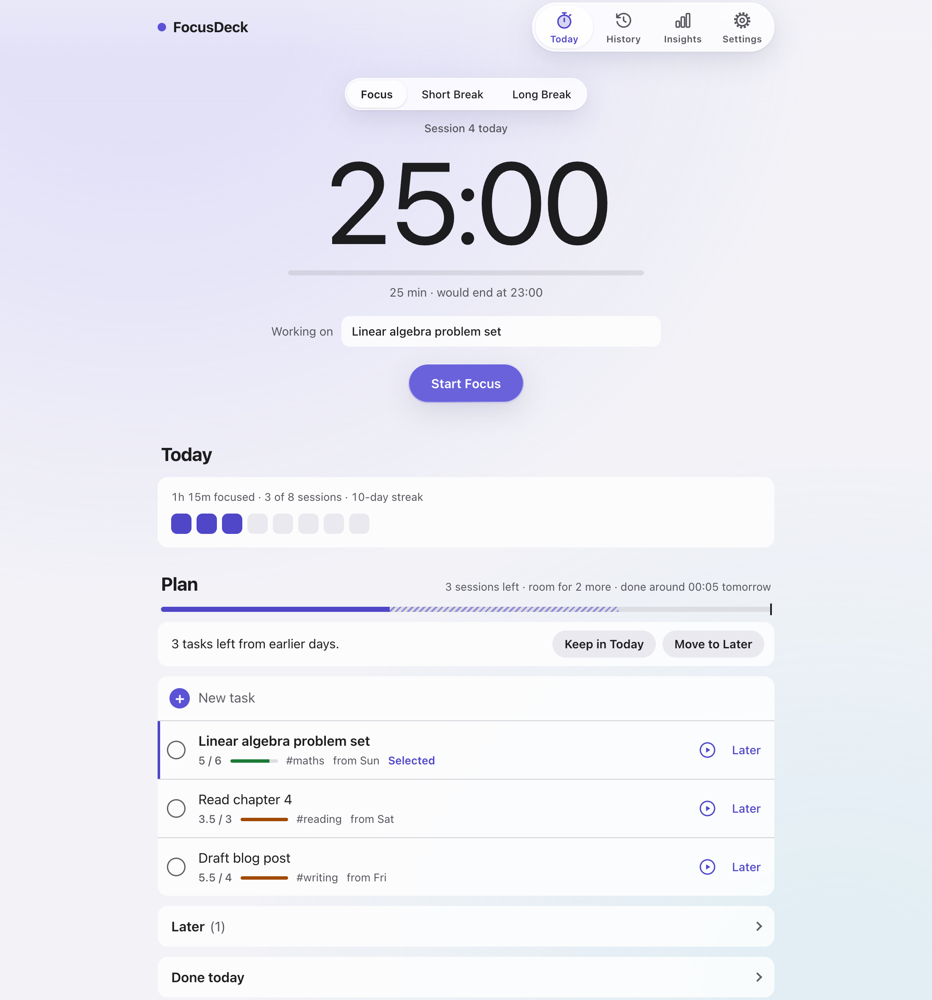
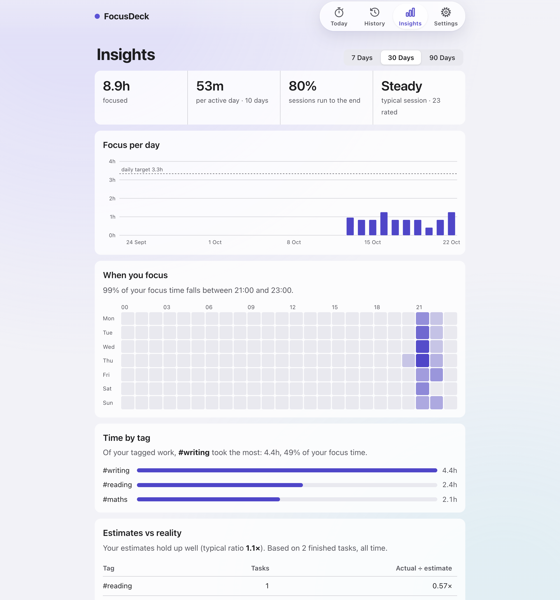
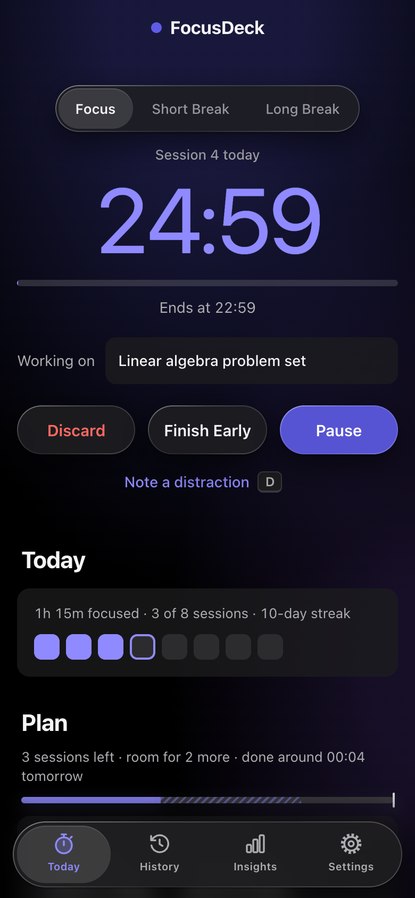

# FocusDeck

A Pomodoro timer, day planner and focus log in a single HTML file. Download it, double-click it, and it works: no install, no account, no internet connection, no tracking.



## What it does

- **Timer that keeps real time.** Focus, short and long breaks. It survives reloads and sleeping laptops, and logs a session that ended while the tab was closed.
- **Honest credit.** A full session counts as 1, *Finish Early* counts the fraction you did, *Discard* counts nothing.
- **Day planning.** Today and Later lists, quick add with `#tag ~estimate`, reordering by mouse, keyboard or touch, and a capacity line that tells you whether today's plan fits your daily target, and when you'd finish at your usual pace. Tasks left from earlier days are flagged once a day, so Today doesn't silt up.
- **Focus helpers.** Press `D` to park a distraction mid-session; rate each session Scattered, Steady or Deep.
- **History.** Every session, day by day. Delete mistakes, log sessions you forgot to time.
- **Insights.** Focus per day, when in the week you focus best, time per tag, how your estimates compare with reality, and session quality.
- **Your data stays yours.** Everything is stored in your browser. Export a JSON backup or a CSV of every session (ready for Excel or pandas). In Chrome and Edge it can also save a backup into a folder you pick every day, such as one that syncs to iCloud or Google Drive. If two weeks pass without a backup, FocusDeck reminds you.
- **Open it in several tabs** and they stay in sync.
- **Light and dark,** following your system. Works at phone width with a bottom tab bar.

| Insights | On a phone, dark mode |
| --- | --- |
|  |  |

## Get started

1. **[Download FocusDeck.html](https://github.com/Ahmed28phantom/focusdeck/releases/latest/download/FocusDeck.html)** from the latest release. Earlier versions are on the [Releases](https://github.com/Ahmed28phantom/focusdeck/releases) page.
2. Double-click it to open it in your browser. Chrome, Edge, Safari and Firefox all work.
3. Type a task, press Return, press its play button.

The full manual is in [docs/USER_GUIDE.md](docs/USER_GUIDE.md).

**Your data lives in the browser you open the file with.** Another browser, a private window or another computer starts empty. Move data with Settings → Backup → Export and Restore.

## Keyboard shortcuts

| Key | Does |
| --- | --- |
| Space | Start, pause or resume |
| N | New task |
| D | Note a distraction |
| 1 / 2 / 3 | Rate the session that just ended |
| Alt ↑ / ↓ (⌥ on Mac) | Move the task you've tabbed to up or down |
| Ctrl Z / ⌘Z | Undo the last change (Shift for redo) |
| ? | Show all shortcuts |

## Privacy and security

- The file makes **no network requests**: no fonts, analytics or external scripts. A Content-Security-Policy enforces this (`connect-src 'none'`).
- Only the app's own script can run, pinned by its SHA-256 hash, so a crafted backup file can't inject code. Imported data is also cleaned field by field.
- Exported CSVs are safe to open in Excel: text that looks like a formula is escaped.
- Nothing is sent anywhere. There is no server.
- **One thing to know about Chrome:** every HTML file you open from your disk shares one storage area there, so any other local HTML file you open in Chrome can read FocusDeck's data. Only open local HTML files you trust.

## Built-in self-check

Settings → Self-check → **Run** runs the built-in tests covering the timer, streaks, stats, imports, input cleaning and color contrast. You can also open the file with `#selftest` at the end of the address.

## Editing the code

FocusDeck is one file: CSS at the top, markup in the middle, and a single script at the end, split into numbered sections (utilities, core logic, state and storage, sound, timer engine, rendering, actions, events, self-check, start-up).

Because the security policy pins the script's hash, **run this after any change to the script**:

```bash
python3 tools/csp_hash.py FocusDeck.html          # update the hash
python3 tools/csp_hash.py --check FocusDeck.html  # check only
```

If you forget, the app shows “FocusDeck couldn’t start” rather than failing silently.

Then run the checks. This needs Node and Google Chrome, and uses a fresh browser profile, so it never touches your data. It checks the hash and runs the self-check in light, dark, Increase Contrast and Reduce Transparency. It also tests what the self-check can't, because it would change your data: two open tabs, ending and undoing sessions, the question sheets, reordering, importing old data, Insights and the backup reminder. GitHub runs the same checks on every push (`.github/workflows/check.yml`).

```bash
cd tools && npm install && cd ..   # once
node tools/check.mjs
```

After a visual change, retake the screenshots in `docs/screenshots/`. It also needs Node and Chrome, and it only ever shows demo data:

```bash
node tools/screenshots.mjs
```

To release, bump the version, add a CHANGELOG entry, and push a tag such as `v5.9`. GitHub runs the checks and publishes the Release with `FocusDeck.html` attached (`.github/workflows/release.yml`). Versioning rules and the history of every release are in [CHANGELOG.md](CHANGELOG.md).

## Design

The interface follows Apple's Human Interface Guidelines, reviewed with the open-source [Apple Design Skill](https://github.com/dickwu/apple-design-skill): system fonts, contrast of at least 4.5:1 for all text, 44-point touch targets on phones, text that scales with the browser's font size, and support for Reduce Motion, Reduce Transparency and Increase Contrast. Indigo means focus, teal means break, red means delete.

FocusDeck is not affiliated with or endorsed by Apple.

## License

[MIT](LICENSE)
